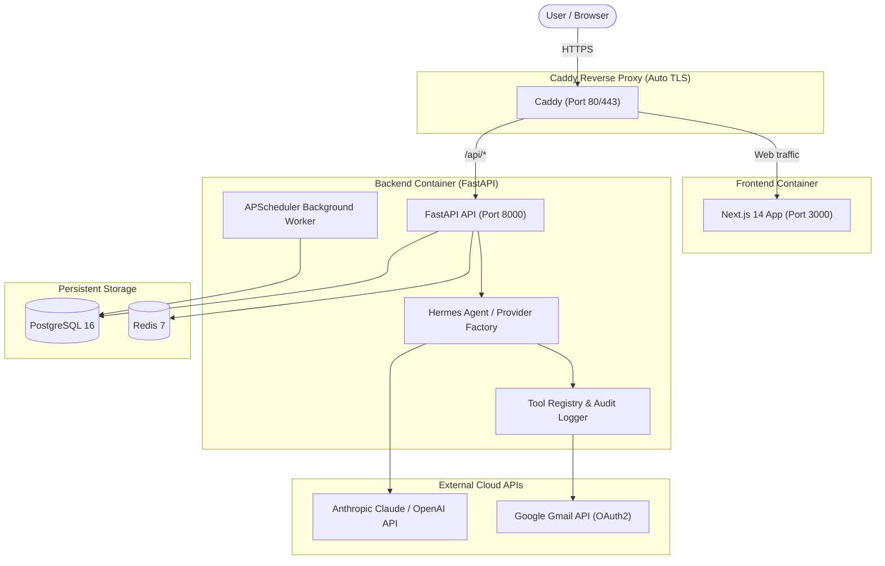

# Personal AI Agent Platform (Jarvis)

A production-ready, 24/7 personal AI assistant platform inspired by Jarvis. Designed to run continuously on a budget VPS (e.g., Hetzner Cloud ~$5/mo), enabling natural text and voice conversations, autonomous tool reasoning with Hermes Agent, and secure email management.

---

## 🌟 Key Features

- **24/7 Always-On VPS Deployment**: Built with Docker Compose, automated restart policies, health checks, persistent volumes, and Caddy reverse proxy with automated Let's Encrypt SSL/TLS.
- **Hermes Agent Engine**: Integrated with NousResearch Hermes Agent (`quiet_mode=True`) for multi-step reasoning, tool execution, and task management.
- **Cloud AI Provider Abstraction**: Supports Anthropic (Claude 3.5/4.5 Sonnet), OpenAI (GPT-4o), and Ollama-compatible local/cloud endpoints.
- **Natural Voice Conversations**: First-class voice mode with push-to-talk and continuous hands-free turn-taking, browser Web Speech STT/TTS with optional server-side Whisper & ElevenLabs providers.
- **Secure Email Management**:
  - Google OAuth2 integration with Fernet encryption for stored credentials.
  - Read, search, summarize individual messages and threads.
  - AI email drafting from natural instructions.
  - **Strict Human-in-the-Loop Send Approval**: Outgoing emails require explicit user confirmation. Atomic status checks strictly prevent duplicate sends.
  - Untrusted data isolation & prompt injection defense.
- **Scheduled Background Monitoring**: Automated inbox monitoring via APScheduler with retry backoff and deduplication.
- **Persistent Memory**: Distinguishes permanent user preferences, approved facts, and conversation history. User can inspect, edit, or delete any memory entry.
- **Controlled Tool Registry**: Defined schemas, input validation, execution timeouts, and audit logging for all agent actions.
- **Budget Optimized**: Designed to stay within a target budget of **~$10–$15 / month**.

---

## 🏗️ Architecture



---

## 💰 Estimated Monthly Operating Costs

| Item | Provider / Service | Monthly Cost | Notes |
| :--- | :--- | :--- | :--- |
| **VPS (2 vCPU, 4GB RAM, 40GB SSD)** | Hetzner Cloud (CX22) | **~$5.00** | Ubuntu 24.04 LTS |
| **IPv4 Address** | Hetzner Cloud | **~$0.60** | Included or nominal add-on |
| **Domain Registration** | Namecheap / Cloudflare | **~$1.00** | ~$10–$12/year amortized |
| **Cloud AI Inference** | Anthropic (Claude Sonnet) | **~$3.00 – $6.00** | Personal usage (~50–100 turns/day) |
| **Voice STT (Speech-to-Text)** | Browser Web Speech API | **$0.00** | Free built-in browser engine |
| **Voice TTS (Text-to-Speech)** | Browser SpeechSynthesis API | **$0.00** | Free built-in browser engine |
| **Total Estimated Cost** | | **~$9.60 – $12.60 / mo** | Well within **$15/month** target |

---

## 🚀 Quick Start (Local Development)

### 1. Clone & Configure Environment

```bash
git clone https://github.com/your-username/personal-ai-agent.git
cd personal-ai-agent

# Create environment file from documented template
cp .env.example .env
```

Open `.env` and configure at minimum:
- `SECRET_KEY`: run `openssl rand -hex 32`
- `JWT_SECRET_KEY`: run `openssl rand -hex 32`
- `OAUTH_ENCRYPTION_KEY`: run `python -c "from cryptography.fernet import Fernet; print(Fernet.generate_key().decode())"`
- `ANTHROPIC_API_KEY`: your Anthropic API key (or `OPENAI_API_KEY`)

### 2. Launch with Docker Compose

```bash
docker compose -f deployment/docker-compose.yml up -d --build
```

### 3. Access Application
- Web UI: [http://localhost:3000](http://localhost:3000) (or `http://localhost` if routed through Caddy)
- Backend API Docs: [http://localhost:8000/docs](http://localhost:8000/docs)
- Health Check: [http://localhost:8000/api/health](http://localhost:8000/api/health)

---

## 🌐 Production VPS Deployment (Hetzner Cloud)

### 1. Provision Server
- Provider: Hetzner Cloud
- Image: Ubuntu 24.04 LTS
- Type: CX22 (2 vCPU, 4 GB RAM)
- Add your SSH public key

### 2. Run Automated Setup Script

SSH into your server and run the included provisioning script:

```bash
ssh root@YOUR_SERVER_IP

# Clone repository
git clone https://github.com/your-username/personal-ai-agent.git /opt/agent
cd /opt/agent

# Make setup script executable and run
chmod +x deployment/scripts/setup-vps.sh
./deployment/scripts/setup-vps.sh
```

The script will:
- Install Docker Engine & Docker Compose plugin
- Configure UFW firewall (exposing only 22, 80, 443)
- Configure log rotation for Docker containers
- Set up automated daily database backup cron job

### 3. Configure Production `.env`

```bash
nano /opt/agent/.env
```

Set your production domain and Let's Encrypt email:
```ini
DOMAIN=assistant.yourdomain.com
CADDY_EMAIL=your-email@example.com
ENVIRONMENT=production
```

### 4. Start Services

```bash
docker compose -f deployment/docker-compose.yml up -d
```

Caddy will automatically request and renew your TLS certificates. Access your assistant at `https://assistant.yourdomain.com`.

---

## 🔑 Google OAuth Setup (Gmail Integration)

1. Open [Google Cloud Console](https://console.cloud.google.com/).
2. Create a new project (e.g. `Jarvis-Agent`).
3. Navigate to **APIs & Services > Library** and enable **Gmail API**.
4. Configure the **OAuth Consent Screen**:
   - User Type: **External** (keep in "Testing" mode and add your email under Test Users).
   - Scopes: `openid`, `userinfo.email`, `https://www.googleapis.com/auth/gmail.readonly`, `https://www.googleapis.com/auth/gmail.send`, `https://www.googleapis.com/auth/gmail.modify`.
5. Navigate to **Credentials > Create Credentials > OAuth client ID**:
   - Application type: **Web application**
   - Authorized redirect URIs: `https://yourdomain.com/api/email/oauth/callback` (or `http://localhost:8000/api/email/oauth/callback` for dev).
6. Copy Client ID and Client Secret into your `.env`:
   ```ini
   GOOGLE_CLIENT_ID=your-client-id.apps.googleusercontent.com
   GOOGLE_CLIENT_SECRET=your-client-secret
   GOOGLE_REDIRECT_URI=https://yourdomain.com/api/email/oauth/callback
   ```

---

## 🛡️ Security & Defense Architecture

- **Human-in-the-Loop Email Sending**: The assistant can only draft emails or queue approval objects. The send API requires explicit user approval and is guarded by atomic state transition to prevent duplicate transmissions.
- **Untrusted Content Sanitization**: Email contents and web results are treated as untrusted data. They are never placed into system prompt instruction positions.
- **Prompt Injection Defense**: Robust system-level directives prevent override attempts inside inbound emails.
- **Encrypted Credential Storage**: OAuth access and refresh tokens are encrypted at rest using 32-byte Fernet symmetric keys.
- **Private Internal Network**: PostgreSQL, Redis, and internal backend communication are isolated inside Docker's bridge network and never exposed to the public internet.

---

## 💾 Database Backups & Restoration

### Create Backup
```bash
/opt/agent/deployment/scripts/backup.sh
```
Backups are compressed with gzip and stored in `/opt/agent/deployment/backups/`. The last 7 days are automatically preserved.

### Restore from Backup
```bash
/opt/agent/deployment/scripts/restore.sh /opt/agent/deployment/backups/agent_backup_YYYYMMDD_HHMMSS.sql.gz
```

---

## 🧪 Automated Testing

Run the complete test suite with pytest:

```bash
cd backend
pytest -v
```

Tests include:
- `test_auth.py`: Authentication, JWT verification, session revocation
- `test_chat.py`: Conversation persistence and SSE streaming
- `test_email.py`: OAuth exchange, inbox listing, approval queue, duplicate prevention
- `test_tools.py`: Tool schema validation, execution timeouts, error handling
- `test_memory.py`: Persistent memory storage, text search, user isolation
- `test_rate_limiting.py`: Request throttling protection
- `test_prompt_injection.py`: Defense against malicious email injection attempts
- `test_e2e_voice_email.py`: End-to-end voice-to-email and approval workflows
